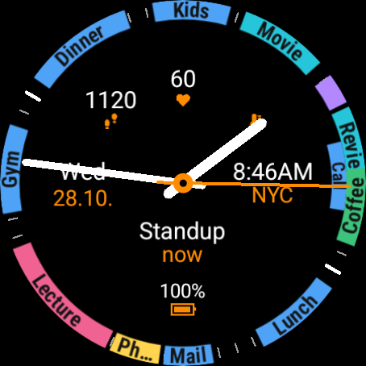

# DayRing

An analog watch face for Wear OS 6 in the [Watch Face Format][wff] (version 4) with an event rim:
the events of the next 12 hours appear around the edge, exactly where they take place
on the dial.



## What is on it

| Area | Display |
| :---- | :---- |
| Rim | Events of the next 12 hours with the title, in the calendar colour or a palette; overlapping ones on an inner lane |
| Top centre | Three small slots with a value and an icon (default: steps, heart rate, temperature), freely assignable |
| Left | Weekday and date |
| Right | World clock (time and city), freely assignable |
| Below the hub | Next event to start: title, with the time underneath |
| Bottom | Battery level with a battery icon |
| Dial ring | Minute ticks, longer hour ticks, bold numbers at 12, 3, 6 and 9, on the outer lane of the rim, covered by events |

The watch's editor offers five colour schemes (Orange, Ice blue, Mint, Coral, Gold) and, for each
slot, the setting **Icon**: the icon of the chosen provider, or one of six own icons (steps, heart,
thermometer, oxygen, sleep, calories).

## Modules

- `watchface`: the watch face (`de.jmb0.dayring.calendar.watchfacepush.dayring`). It contains no
  code, only `res/raw/watchface.xml` and images.
- `calendar`: the app that is installed and published (`de.jmb0.dayring.calendar`, named
  "DayRing"). It carries the watch face and provides it with two complications:
  - `EventRingService` draws the event rim as an image.
  - `NextEventService` provides the next event to start as text; one that is already running
    only if no other one starts within the 12 hours.

The app installs the watch face with [Watch Face Push][wfp]: the build validates the watch face APK
and puts it with its validation token into the app (`BundleWatchFaceTask` in
`calendar/build.gradle.kts`), and Wear OS installs it together with the app. `WatchFaceInstaller`
puts it back if it was removed and replaces it after an app update with a newer bundled version.
Watch Face Push requires the package name of the watch face to start with the app's package name
followed by `.watchfacepush.`.

Open the app once to grant calendar access. Its button **Use as watch face** makes DayRing the
current watch face; Wear OS allows that only once, after that the watch face is chosen on the watch
as usual. Tapping the rim or the next event opens the watch's calendar app.

The colour button in the app switches the colours of the rim:

- **Palette** (default): six fixed colours. The colour follows the start time (the next colour every
  quarter of an hour), so an event keeps its colour and events close together differ.
- **Calendar**: the colour of the event, or else of its calendar, as on the phone. If the provider
  supplies no colour, the palette is used.

The title is drawn in black or white, whichever contrasts more with the arc.

## Event rim

The rim has no background of its own: where there is no event, it is black and shows the dial
ring. All events go on the outer lane. The inner lane is used only for an event
that starts while the outer lane is still busy, so overlapping events stay visible. The number of
events is not limited: the rim is drawn as one image. Each arc is at least long enough for about
7 characters of its title (roughly 45 minutes); if the next event on the same lane starts sooner,
the arc stays short and its title is shortened or left out. Even an event of a few minutes gets a
short arc. An arc near the end of the 12 hours that would reach round onto an event at their
start moves to the inner lane if that is free there. A third event that overlaps two others is
drawn over one of them.

The dimensions of the rim are defined in two places that have to match: `RingRenderer.kt` (radii
and lane width) and the dial ring in `watchface.xml` (on the outer lane).

## Privacy

The app only reads calendar events (`READ_CALENDAR`) and processes them on the watch. It
has no network access and passes nothing on. Steps, heart rate and everything else come from the
providers you choose in the editor.

## Building

Requirements: Android Studio with a current Android SDK (compileSdk 36), JDK 17 or newer. The
build loads the Watch Face Push validator from Google's Maven repository and one of its libraries
from JitPack.

```shell
./gradlew :calendar:assembleDebug
```

This also builds the watch face (always its release build) and validates it; the build fails if the
watch face does not pass the validation. The APK ends up in `calendar/build/outputs/apk/debug/`.
Opening the project in Android Studio for the first time creates a `local.properties` with the SDK
path; it does not belong in the repository.

Without a `keystore.properties` (see [Publishing](#publishing)) the release build is signed with the
debug key and is only meant for trying it out.

## Publishing

Only the app in `calendar` goes to Google Play, as one entry; it brings the watch face along. Texts
for the entry are in [docs/store-listing.md](docs/store-listing.md), the privacy policy in
[docs/privacy.md](docs/privacy.md).

1. Create two keys once and keep the keystore (and a backup) outside the repository: the upload
   key for the app and, as Google recommends for Watch Face Push, a key of its own for the watch
   face. Unlike the app, the watch face is not re-signed by Google Play, so this key signs every
   future version of it.

   ```shell
   keytool -genkeypair -v -keystore ~/keys/dayring.jks -alias upload \
       -keyalg RSA -keysize 4096 -validity 10000
   keytool -genkeypair -v -keystore ~/keys/dayring.jks -alias watchface \
       -keyalg RSA -keysize 4096 -validity 10000
   ```

2. Create `keystore.properties` next to `settings.gradle.kts`. It is in `.gitignore`;
   relative paths are resolved from the project root.

   ```properties
   storeFile=/home/me/keys/dayring.jks
   storePassword=...
   keyAlias=upload
   keyPassword=...
   watchfaceKeyAlias=watchface
   watchfaceKeyPassword=...
   ```

3. Raise `versionCode` (and `versionName`) in `calendar/build.gradle.kts` for every upload. If the
   watch face changed, raise its `versionCode` in `watchface/build.gradle.kts` too; otherwise
   watches that already have it keep the old version. Then build the bundle:

   ```shell
   ./gradlew :calendar:bundleRelease
   ```

   It ends up in `calendar/build/outputs/bundle/release/`.

4. In the Play Console, turn on Play App Signing and upload the bundle.

## Installing and trying it out

The watch face needs Wear OS 6 (API 36). On a watch or in the emulator:

```shell
adb install -r calendar/build/outputs/apk/debug/calendar-debug.apk
adb shell pm grant de.jmb0.dayring.calendar android.permission.READ_CALENDAR
```

Install only the app: it installs the watch face itself. A watch face installed separately with
`adb install` under the same package name can get in the way; remove it first with
`adb uninstall de.jmb0.dayring.calendar.watchfacepush.dayring`. Then open the app and tap
**Use as watch face**, or activate it with ADB:

```shell
adb shell am broadcast -a com.google.android.wearable.app.DEBUG_SURFACE \
    --es operation set-watchface --es watchFaceId de.jmb0.dayring.calendar.watchfacepush.dayring
```

The complication slots can be assigned with ADB too (`--es operation set-complication`, see the
[documentation of the format][wff-complications]). Note that the slot numbers do not follow the
`slotId` in `watchface.xml`, but the order of the `ComplicationSlot` elements.

To test the events in the emulator, entries can be written to the local calendar:

```shell
adb shell content insert --uri content://com.android.calendar/events \
    --bind calendar_id:i:1 --bind title:s:Meeting \
    --bind dtstart:l:<start in ms> --bind dtend:l:<end in ms> \
    --bind eventTimezone:s:Europe/Berlin
```

## Notes

- On watches that do not store events themselves (for example Samsung), Wear OS mirrors them from
  the phone into a calendar provider of its own. The app reads both sources.
- The icon of a slot is chosen in the editor because the format does not reveal which provider is
  assigned. "Automatic" shows the provider's own icon if it supplies one.
- Coordinates and sizes in `watchface.xml` must be whole numbers. Decimal values in `x`, `y`,
  `width` and `height` of texts and images make the element disappear on the watch.
- The date is shown as day and month with dots (for example `3.10.`).

## License

Apache License 2.0, see [LICENSE](LICENSE). The project started from a sample for the Watch Face
Format ([android/wear-os-samples][samples], Apache 2.0). The Gradle files and the manifest of the
watch face still carry the original copyright notice from Google.

[wff]: https://developer.android.com/training/wearables/wff
[wfp]: https://developer.android.com/training/wearables/watch-face-push
[wff-complications]: https://developer.android.com/training/wearables/wff/complications
[samples]: https://github.com/android/wear-os-samples
